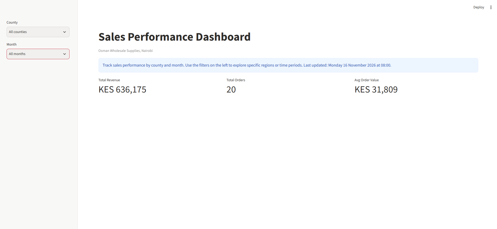

# Sales Performance Dashboard

A Python script that turns sales data into a Streamlit web Dashboard that helps sales manager to track sales records.
>I used a small sample data



## Setup

```bash
pip install -r requirements.txt
```

## Usage

Run the program from the project's folder where the sales_data.csv file is saved. 
```
streamlit run app.py
```
## How It Works

- `pd.read_csv("sales_data.csv")` Loads sales CSV file 
- `filtered = df.copy()` Creates two filter functions (Month, County)
- `k1, k2, k3 = st.columns(3)` Adds KPIs on a single row (Total Revenue, Total Orders, Average Order Value)


## Stack

- **Python**: core language
- **Streamlit**: web interface (class dropdown, date picker, charts, runs in the browser on phone or laptop)
- **pandas**: loading the CSV and calculating key metrics

